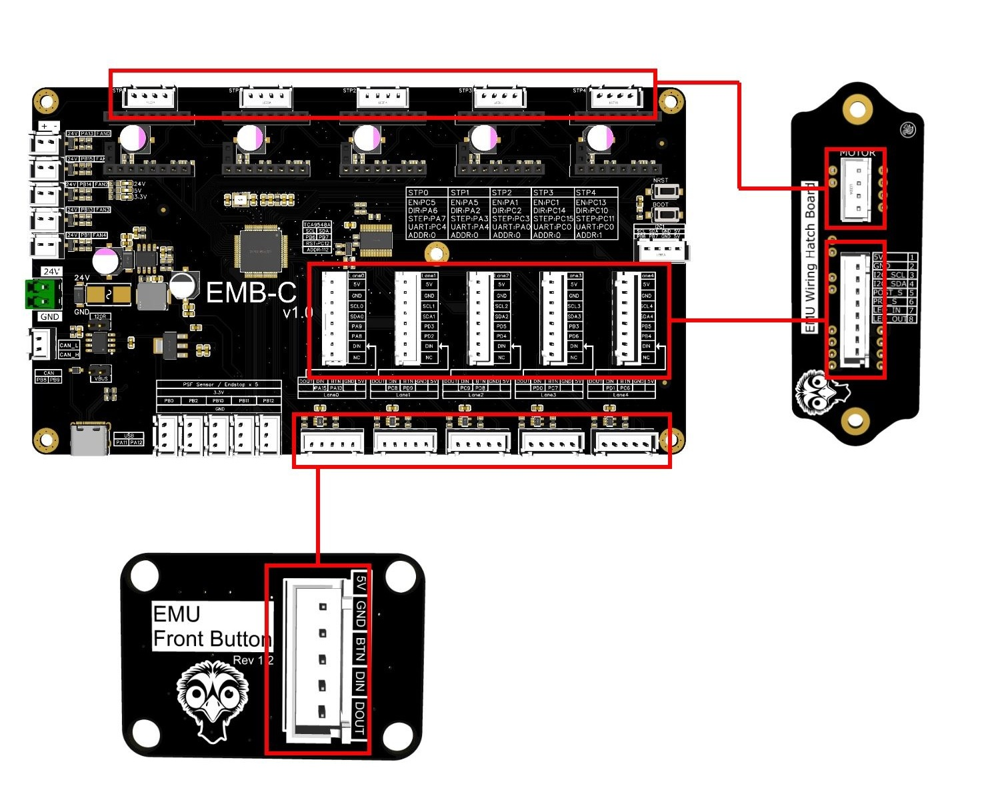
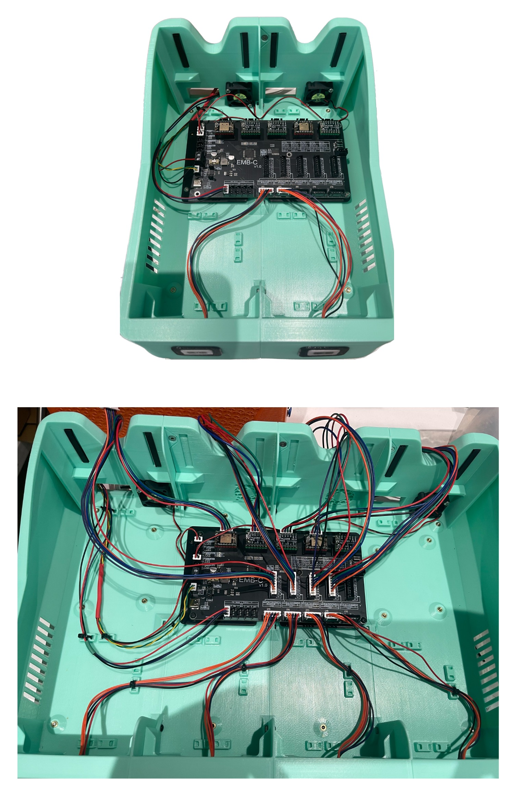

# EMB

[中文](README_CN.md)

EMB-C is a single-board solution for a two- to five-lane EMU.

Happy Hare has integrated support for the EMB-C board. Support is currently available in the
[development branch](https://github.com/moggieuk/Happy-Hare/tree/development) and will be included
in the stable 4.3 release.

- [Happy-Hare-Config](Happy-Hare-Config/README.md): Happy Hare configuration templates.
- [AFC-Config](AFC-Config/README.md): AFC configuration templates.

Before replacing any existing configuration with these templates, back up the original files. This makes it easier to recover from or investigate compatibility issues after Happy Hare or AFC upgrades.

Hardware documentation and further setup details will be added later.

## Wiring diagram

## Installation examples

