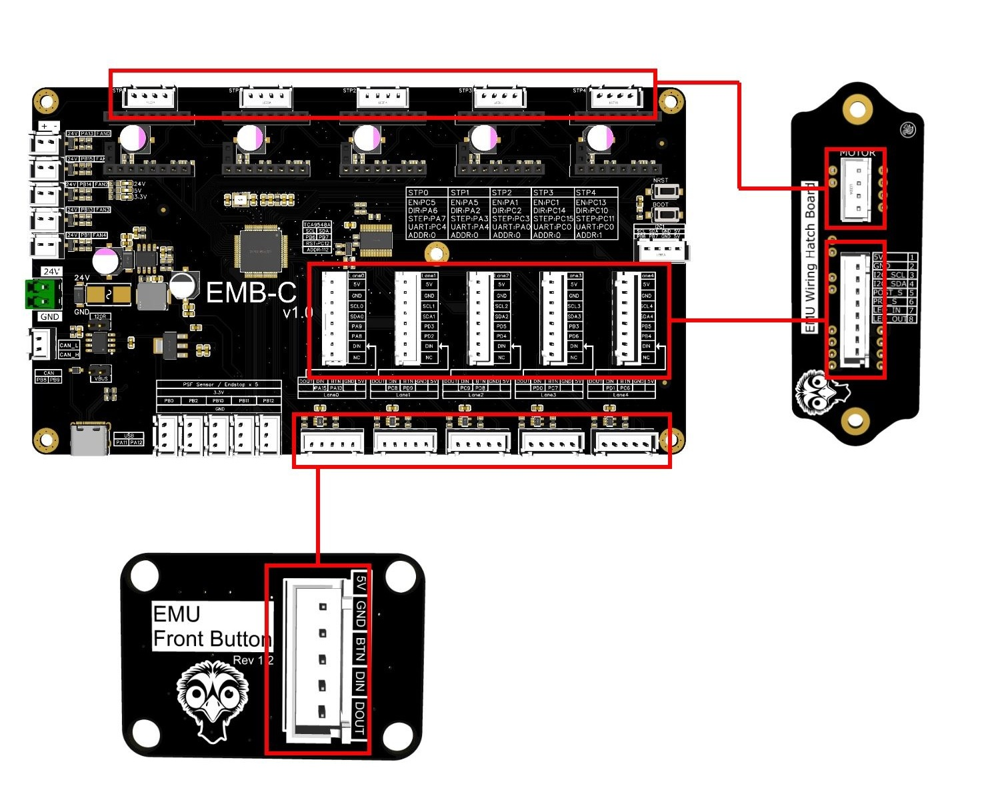
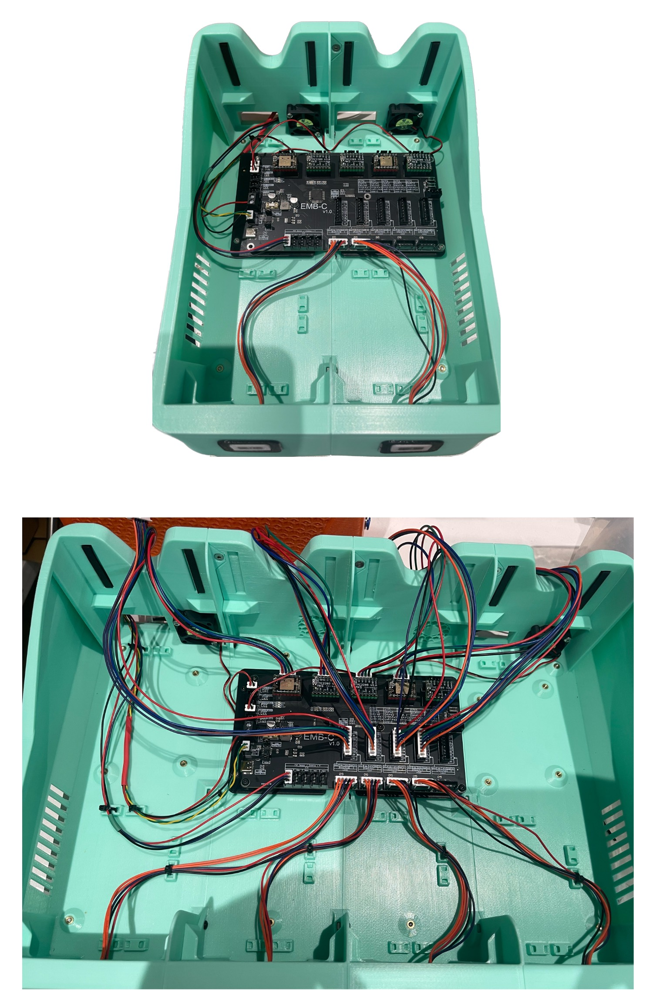

# EMB

[English](README.md)

EMB-C 是用于 2-5 通道 EMU 的单主板方案。

Happy Hare 已集成对 EMB-C 主板的支持，目前可在
[development 分支](https://github.com/moggieuk/Happy-Hare/tree/development) 中使用，
并将随 4.3 正式版发布。

- [Happy-Hare-Config](Happy-Hare-Config/README_CN.md)：Happy Hare 配置模板。
- [AFC-Config](AFC-Config/README_CN.md)：AFC 配置模板。

在使用这些模板覆盖已有配置前，建议备份相关原始配置文件。这样在 Happy Hare 或 AFC 升级后出现兼容性问题时，可以更方便地恢复或排查。

硬件资料和更详细的使用说明将后续补充。

## 接线示意

## 安装示例

